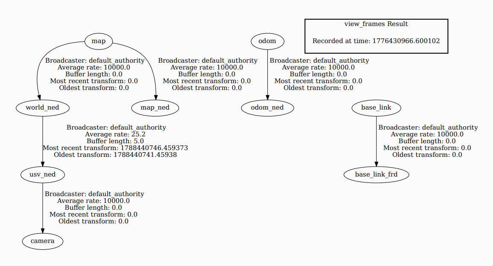
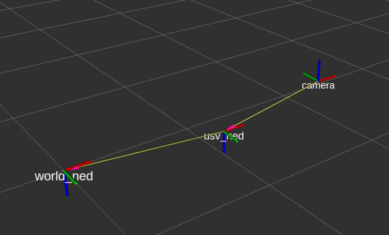

The goal of this package is to unify and simplify the process of handling the reference frames used along with selene. The local ENU reference frame captured in the topic **/ap/pose/filtered** is converted to NED and the position of the camera is defined relative to that NED pose.

## Repository purpose and scope

ROS 2 C++ package publishing Selene's TF reference-frame tree for navigation and perception. It connects the world, moving boat and camera frames.

The current [DynamicFramePublisher](include/broadcasters/DynamicFramePublisher.hpp) reads PX4 `/fmu/out/vehicle_odometry` using `px4_msgs/VehicleOdometry`. Frame relationships and fixed offsets are defined in [TransformBroadcasterNode.hpp](include/TransformBroadcasterNode.hpp). [usv_bringup](https://github.com/Sub-Horizon-NTNU/usv_bringup) starts this package as part of the companion stack.

The package has a [ROS 2 launch entry point](launch/transform_broadcaster.launch.py). Existing documentation and camera-offset parameters do not fully match the implementation; see [docs/INCONSISTENCIES.md](docs/INCONSISTENCIES.md).
